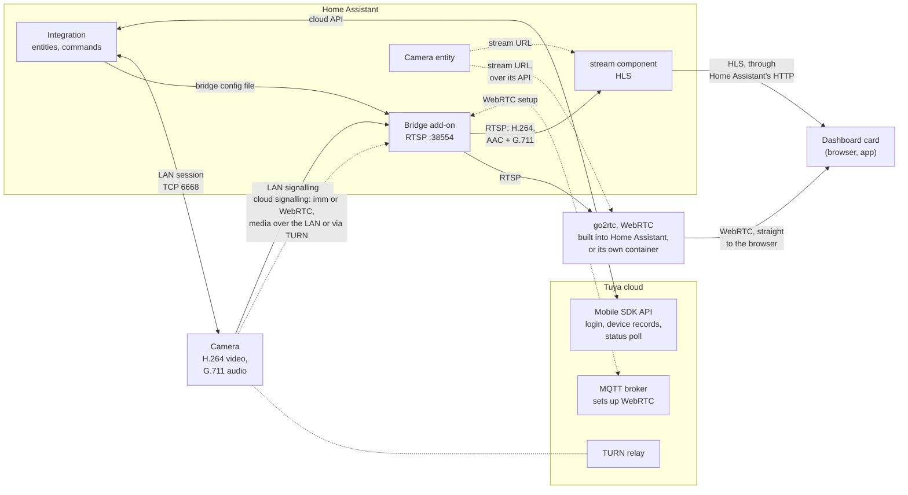
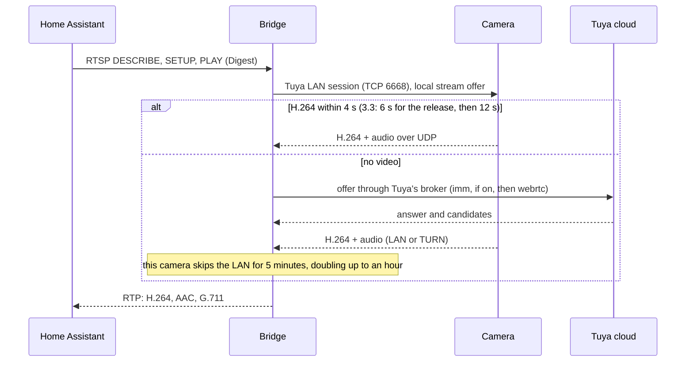
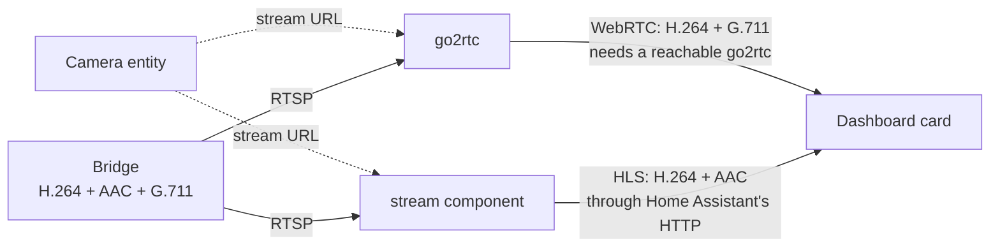

# Philips Avent Baby Monitor — Home Assistant Integration

<p align="center">
  
</p>

[](LICENSE)
[](https://github.com/thekoma/aventproxy/actions/workflows/ci.yml)
[](https://github.com/hacs/integration)

Home Assistant integration for Philips Avent SCD973/SCD923 baby monitors, providing local streaming, temperature monitoring, night light control, lullaby playback, and motion/sound alerts.

## Features

| Feature | Entity Type | Description |
|---------|-------------|-------------|
| 📹 Live Video | Camera | 1080p H.264 stream via WebRTC→RTSP bridge, over your local network when possible |
| 🌡️ Temperature | Sensor | Room temperature from built-in sensor |
| 💡 Night Light | Switch + Number | On/off + brightness 1-100% |
| 🎵 Lullabies | Buttons + Number | Play/pause/stop/next/prev + volume |
| 🏃 Motion Alert | Switch | Motion detection on/off |
| 🔊 Sound Alert | Switch | Sound detection on/off |
| 🏃 Motion Detected | Binary Sensor | Fires when motion is detected (auto-clears after 30s) |
| 🔊 Sound Detected | Binary Sensor | Fires when sound is detected (auto-clears after 30s) |
| 🔒 Privacy Mode | Switch | Camera on/off |

The video travels over your local network whenever the bridge can reach the monitor directly. On monitors that allow it, the signalling that starts a stream stays local too, so no cloud call is needed. See [Local streaming](#local-streaming) below.

Monitors with SenseIQ also get sleep and presence entities. Among them are Baby Detected, Baby Moving, Breathing rate, Sleep stage (awake, light, deep, out of bed, settling), the sleep duration and a nightly summary.

Multiple monitors on one Tuya account are supported: the bridge serves each camera from the same port on a distinct RTSP path derived from the camera's display name.

## Supported devices

The integration is model-agnostic (it talks to the Tuya cloud API generically), so other Philips Avent monitors may work even if they are not listed here. Status below reflects what users have actually confirmed:

| Model | Status |
|-------|--------|
| SCD973 / SCD923 | ✅ Fully supported (primary development hardware) |
| SCD953/26 | ✅ Working, including motion and sound alerts (confirmed in 2026.8.0, [#42](https://github.com/thekoma/aventproxy/issues/42)) |
| SCD951 | ✅ Working, including motion and sound alerts (confirmed in 2026.8.0, [#61](https://github.com/thekoma/aventproxy/issues/61)) |
| SCD643/26 | ✅ Working |
| SCD971 | ✅ Working |
| SCD921 | ⚠️ Partial: video works but is intermittent; motion/sound detection and WiFi signal behave inconsistently ([#40](https://github.com/thekoma/aventproxy/issues/40)) |
| SCD860 | ❓ Requested, not yet confirmed ([#59](https://github.com/thekoma/aventproxy/issues/59)) |

Motion and sound alerts do not travel the same way on every monitor. Some report them on DPS 250 and 141, such as an SCD973 on firmware 1.4.0. Others use a timestamped alarm record on DPS 212 instead: the SCD951, the SCD953, and the SCD973/26 in Leonard Pitzu's fork. The choice follows the firmware, not the model, so the integration reads both on every monitor. Both shapes are handled since 2026.8.0. If your monitor raises an alert the app notifies you about and Home Assistant stays quiet, the log now names the alert Tuya sent, which usually turns the fix into one line.

LAN streaming has only been tested on an SCD973/26.

Got a model that isn't listed, or one that misbehaves? A [diagnostics dump](docs/reporting-issues.md) is the fastest way to get it mapped.

## Installation

### Integration (HACS)

[](https://my.home-assistant.io/redirect/hacs_repository/?owner=thekoma&repository=aventproxy&category=integration)

Or manually:

1. Open HACS → Integrations → Three dots menu → Custom repositories
2. Add `https://github.com/thekoma/aventproxy` as category **Integration**
3. Install "Philips Avent Baby Monitor"
4. Restart Home Assistant

### Add-on (WebRTC Bridge)

[](https://my.home-assistant.io/redirect/supervisor_add_addon_repository/?repository_url=https%3A%2F%2Fgithub.com%2Fthekoma%2Faventproxy)

Or manually:

1. Settings → Add-ons → Add-on Store → Three dots → Repositories
2. Add `https://github.com/thekoma/aventproxy`
3. Install "Philips Avent WebRTC Bridge (Addon)"

**Three cards, one choice.** The store shows the bridge three times:

| Card | Install it when |
|------|-----------------|
| Philips Avent WebRTC Bridge (Addon) | You run a stable release of the integration |
| Philips Avent WebRTC Bridge Beta (Addon) | You run a beta or rc build of the integration |
| Philips Avent WebRTC Bridge Dev (Addon) | Someone asked you to test a specific fix off main. No release notes, no promises |

Keep both sides on the same version. The two halves talk over a config file whose contents grow with each release, so a stable bridge paired with an rc integration can miss a field it needs. As an example, bridges before 2026.7.0-rc2 do not read `api_host`, so an account outside Europe logs in and then fails to stream.

### Setup

[](https://my.home-assistant.io/redirect/config_flow_start/?domain=philips_avent)

1. Go to Settings → Integrations → Add Integration → **Philips Avent Baby Monitor**
2. Enter your email and password (same as the Baby Monitor+ app), and check that the country matches the one your Avent account was created in (it is pre-filled from your Home Assistant country)
3. Check your email for the 6-digit verification code
4. Enter the code — done!

The integration discovers your cameras automatically and creates all entities. The bridge add-on starts streaming.

The country matters: a Philips/Tuya account lives in one regional server, and the session from one is not valid on another. Getting it wrong shows up as a login that fails right after you type the verification code.

### Running the bridge outside Home Assistant

Two-way audio is off by default. Asking the camera for it makes the monitor stop a playing lullaby and restart it from the beginning when you close the stream, so listening does not imply talking. If a client of yours really talks back through the RTSP stream, turn on **Two-way audio (talkback)** under Configure. Home Assistant 2026.11 can be that client: with talkback on, the camera tells it that it takes audio, and the camera dialog shows a microphone once the two-way audio preview is on under Settings → System → Labs (it needs HTTPS and a WebRTC stream). With the Dev card's `talkback_mode: on_demand`, the default there, the monitor is asked for two-way audio only while someone talks, so the lullaby pauses only then (see the Dev card's changelog). On some monitors a stream pauses a playing lullaby even with two-way audio off ([#72](https://github.com/thekoma/aventproxy/issues/72)). On an SCD973 the cause turned out to be the webrtc session itself: the monitor treats it as the app talking. The `cloud_transport: imm` option of the Dev and Beta cards avoids it there (see [imm over cloud signalling](#imm-over-cloud-signalling-dev-and-beta-cards-experimental)). The Dev card's `speaker_off` option, described in its changelog, did not help.

If you don't run the add-on but host the bridge yourself, in its own container or on another machine, tell the integration where to find it: **Settings → Integrations → Philips Avent → Configure → Bridge host**. It defaults to `localhost`, which is only correct when the bridge shares the network with Home Assistant. A wrong host makes the camera entity flap between `Unavailable` and `Idle`, because Home Assistant marks a camera unavailable while its stream cannot be opened.

#### Who can reach the RTSP stream

The integration generates a password for the bridge's RTSP streams (`rtsp_password` in the bridge config, 32 random bytes, kept in the config entry) and opens `rtsp://homeassistant:<password>@<host>:38554/<camera>`. Every RTSP request must then authenticate with Digest (Basic is refused, so the password never crosses the wire), and no stream starts before it has. The bridge's `/status` and its endpoints for the shared LAN connection need the integration's bearer token (`api_token`), because the status names each camera and shows when someone watches. The stream URL is never logged by the integration, and the password is left out of diagnostics. One place it does show: for a camera snapshot, Home Assistant's ffmpeg gets the stream URL on its command line, so anyone who can list processes on the Home Assistant host (`ps`) can read the password while a snapshot runs. That takes a shell on that host already, which also gives the config entry itself. A bridge config without `rtsp_password` (an older integration) leaves the streams without a password, as before, and the bridge logs a warning.

Other limits: at most 16 RTSP connections at once, 64 headers per request and 4 KiB per line; talkback's return channel exists only with talkback on, and its UDP port takes audio only from the RTSP client that set it up. The bridge logs at `info` by default (`log_level` in the bridge config, or `LOG_LEVEL` in the environment, for `debug` or `trace`); its own lines show camera ids as their first six characters.

Even with the password, the add-on listens on loopback only (`localhost`, i.e. 127.0.0.1 and ::1) by default: Home Assistant runs on the host network next to it and opens `rtsp://localhost:38554/<camera>`, so nothing else on your network can watch the nursery. If another machine must open the stream (VLC, Frigate, a separate go2rtc, or Home Assistant itself when the bridge runs elsewhere), set the add-on option **RTSP bind address** (`rtsp_bind_address`) to `0.0.0.0`, to one address, or to a comma-separated list, and restrict port 38554 on your network. Outside the add-on, pass `--bind` to `avent-webrtc-bridge addon` or set `RTSP_BIND_ADDRESS` for `run.sh` (see `docker-compose.yml`).

### Automations

The integration exposes `binary_sensor.<camera>_sound_detected` and `binary_sensor.<camera>_motion_detected` that turn on for ~30 seconds when the monitor reports an event. They are the trigger points for any automation.

Note: detection must be enabled on the device side via the `🔊 Sound Alert` / `🏃 Motion Alert` switches — otherwise the monitor never sends the event. On a monitor whose LAN session has confirmed protocol 3.4 or newer, only one detector runs at a time. Turning one switch on there turns the other off, and turning one off leaves the other alone.

```yaml
# Mobile notification when sound is detected
automation:
  - alias: "Baby crying alert"
    trigger:
      - platform: state
        entity_id: binary_sensor.baby_monitor_sound_detected
        to: "on"
    action:
      - service: notify.mobile_app_my_phone
        data:
          title: "Sound detected in nursery"
          message: "Baby may be awake"

# Pop up the camera feed on a dashboard when motion is detected
  - alias: "Show baby cam on motion"
    trigger:
      - platform: state
        entity_id: binary_sensor.baby_monitor_motion_detected
        to: "on"
    action:
      - service: browser_mod.popup
        data:
          content:
            type: picture-entity
            entity: camera.baby_monitor
            camera_view: live
```

## How It Works

The integration uses the same Tuya Mobile SDK API as the official Philips Avent Baby Monitor+ app. Authentication uses the same password + MFA flow — your traffic is indistinguishable from the real app.

Three parts work together: the **integration** (entities, commands, status), the **bridge** (turns the camera's video into RTSP) and Home Assistant's own **players** (WebRTC through go2rtc, and HLS), which bring the video to a dashboard.



Dotted lines from the camera are the cloud-signalled paths; dotted lines from the camera entity carry only the stream URL. Commands and status go between the integration and the camera, over the cloud or the LAN (**Prefer the LAN**). The video goes from the camera to the bridge, and from the bridge to both players, never through the integration: the camera entity only hands each player the stream URL. go2rtc is Home Assistant's WebRTC server; Home Assistant runs its own copy unless `go2rtc: url:` points at a separate one ([From the bridge to the dashboard](#from-the-bridge-to-the-dashboard) says when you need that).

The settings that shape this, and where they act:

| Setting | Where | What it changes |
|---|---|---|
| **Camera LAN addresses** | Configure | Addresses for the integration's LAN session and the bridge's LAN signalling; `camera=address` binds an address to one camera (required on protocol 3.3) |
| **LAN streaming** | Configure | Off: no LAN signalling, and no local key or P2P password in the bridge config |
| **Prefer the LAN** | Configure | Commands and status over the LAN only, the cloud as little as possible; not the video |
| **Share the LAN connection while streaming** | Configure | The integration uses the bridge's LAN session while it streams instead of a second one (on by default) |
| **Use WebRTC** | Configure | Off: video only from the local stream, no MQTT connection, no two-way audio |
| **WebRTC over the LAN only** | Configure, WebRTC page | No STUN or TURN: WebRTC media stays on the LAN |
| **Two-way audio (talkback)** | Configure, WebRTC page | Adds a return channel to the RTSP stream, on every path but Local stream only; asking the camera for it restarts a playing lullaby, with the bridge's `--talkback-mode on_demand` only while someone talks |
| **Stop the stream after (minutes)** | Configure | Ends a stream this long after it started, even while it is watched; 0, the default, is no limit |
| **Sound for Home Assistant's own player (AAC)** | Configure | The AAC copy of the audio for HLS (on by default) |
| **Stream source** | per camera | Local first, WebRTC first, local only or WebRTC only |
| **Local stream quality** | per camera | HD (1080p, the default) or Standard (720p) for the local stream |
| **RTSP bind address** | add-on option | Which addresses the bridge's RTSP port listens on (loopback by default) |
| **cloud_transport** | add-on option, Dev and Beta cards | `imm` tries the app's own transport with cloud signalling before the webrtc session |

### Local streaming

The video already travels over your local network whenever the bridge and the monitor can reach each other directly. ICE picks the monitor's LAN address, and a capture on an SCD973 showed every media packet coming straight from the monitor. What can go through the Tuya cloud is the *signalling*, the short exchange that starts a stream. The bridge log names each stream by it: `Streaming <camera> with cloud signalling` or `Streaming <camera> with LAN signalling`. LAN signalling, on the monitors that allow it (below), needs no cloud call, so a stream still starts when Tuya or your internet connection is down.

The bridge tries LAN signalling first, under these conditions:
- the stream is HD, and talkback is off or on demand;
- LAN streaming is on;
- the camera has a local key and a P2P password;
- the integration knows the camera's LAN address, or **Camera LAN addresses** lists it.

The monitor must speak Tuya LAN protocol 3.4 or 3.5 (an SCD951 speaks 3.4), or 3.3 on an address bound to it under **Camera LAN addresses** (`camera=address`); the bridge offers only the version the integration's own session negotiated, and a camera whose version is not known yet keeps cloud signalling ([Tuya protocol versions](#tuya-protocol-versions)). A 3.3 monitor without a bound address keeps cloud signalling, and the bridge log says `Not using LAN signalling for <camera>: protocol 3.3 without one bound address`. The stream must deliver H.264, otherwise the first-frame check below sends it to the cloud. `/sd` streams, and talkback in its session-wide mode, always use cloud signalling. The monitor must also have reached the internet once since it booted, or it sends no media to a stream with LAN signalling.

If no H.264 video arrives within 4 seconds of a LAN attempt, the same start falls back to cloud signalling and that camera skips the LAN for 5 minutes. An HEVC monitor ends up here. A LAN stream that dies restarts on the cloud with the same 5-minute wait. Each further LAN failure in a row doubles the wait, up to an hour, so a monitor whose LAN never works is not probed every 5 minutes for good; a LAN stream that works ends the streak. If cloud signalling fails as well, the wait is cleared, so the next start tries the LAN again. Once the wait is over, a stream on the cloud checks the LAN in the background and moves its viewers back, with one short reconnect. RTSP clients see the same H.264 video and audio either way: the camera's G.711, and an AAC copy of it first ([From the bridge to the dashboard](#from-the-bridge-to-the-dashboard)).

In the default mode, **Automatic: local first**, a stream starts like this:



The **LAN streaming** option in the integration options is on by default. Turn it off if a stream stopped working after an update, and open an issue with your monitor model and the bridge log. While it is off, the bridge config holds no local key or P2P password.

#### Stream source and local stream quality

Each camera has a **Stream source** select among its configuration entities, which picks the bridge path its camera entity streams from. Other RTSP clients can use the same paths:

| Option | Bridge path | What it does |
|---|---|---|
| Automatic: local first | `rtsp://<bridge>:38554/<camera>` | The default, as described above. |
| Automatic: WebRTC first | `<camera>/webrtc-first` | The cloud session first, LAN signalling when it does not start or sends no video within 5 seconds. Every stream tries the cloud first again. |
| Local stream only | `<camera>/local` | LAN signalling only, with no cloud call and no fallback: when the monitor does not answer within 20 seconds, the stream fails. Its failures do not start the 5-minute wait of the automatic path. It has no two-way audio: the bridge offers no return channel, and the camera entity does not declare two-way audio to Home Assistant. |
| WebRTC only | `<camera>/webrtc` | The cloud session only; the bridge config then holds no local key or P2P password for that camera. |

The last three are offered only for a camera that can stream locally (LAN streaming on, a local key, and on protocol 3.3 an address bound to it). Changing the choice moves a running stream to the new path; only a move to or from WebRTC only rewrites the bridge config, which restarts the add-on's bridge.

A camera holds one local session at a time, whatever the path: one for the bridge, at most one for the integration's own LAN session, and the third the monitor allows left for the parent unit. A `/local` request while another stream of the camera uses its local session is refused (RTSP 503), and an automatic stream that finds it taken uses the cloud without counting that as a LAN failure.

Each camera that can stream locally also has a **Local stream quality** select: **HD (1080p)**, the default, or **Standard (720p)**, what the Philips Avent app asks for. Standard costs the camera less while it also streams to the parent unit. A camera set to Standard asks the cloud session for SD too. Measured on an SCD951 over protocol 3.4 (01-11-2026): Standard gives 1280x720, HD 1920x1080 at 25 fps. Changing it rewrites the bridge config, so the running streams of all cameras drop for a moment.

**WebRTC over the LAN only** (`webrtc_lan_only` in the bridge config), on the WebRTC page of Configure, keeps the cloud session's video on your network as a rule rather than by luck. The bridge then ignores the STUN and TURN servers Tuya hands out, so it gathers only its own LAN addresses and never allocates a relay, and it uses only the camera's host candidates on a private address (RFC 1918, link-local, IPv6 ULA `fc00::/7`): server-reflexive and relay candidates are dropped from the answer and from trickled candidates, and the ICE agent ignores connectivity checks from any public address. A host candidate on a public address or an mDNS name is kept on the camera's address instead, when the integration knows exactly one, and so is a server-reflexive one whose base is a known address of the camera. The setup still goes through Tuya's MQTT broker, and WebRTC cannot connect when the camera is on another network than the bridge. It applies to every cloud session: WebRTC only, WebRTC first, and the automatic path's fallback.

A diagnostic **Stream path** sensor per camera shows what the bridge actually does: **Local** (LAN signalling), **imm (cloud signalling)**, **WebRTC** or **Idle**, with the video size, since when, the stream mode, and the last time it fell back from one path to the other and why (the kind of failure, never an address). The bridge serves this as read-only JSON on `/status`, on the port after its RTSP port and on the same addresses. It holds no keys, passwords or addresses, lists the cameras' device ids, and answers only with the integration's bearer token (above); Home Assistant polls it every 2 seconds.

Under Configure, **Use WebRTC** (on by default) can leave the cloud session out altogether: the Stream source select then offers only Local stream only, a camera without a local stream has no video, and the bridge refuses `/webrtc`, serves the other paths as the local stream and makes no MQTT connection. Two-way audio and WebRTC over the LAN only need WebRTC and sit on a second page of Configure that appears only while WebRTC is on; they keep their values while WebRTC is off. **Stop the stream after (minutes)** ends a camera's stream that many minutes after it started, on either path and even while a client still shows it, so a screen left on a live picture does not keep the camera streaming next to the parent unit; 0, the default, means no limit.

#### imm over cloud signalling (Dev and Beta cards, experimental)

The Dev and Beta cards have a `cloud_transport` option for streams that do not take the LAN, such as every stream from a 3.3 monitor. `webrtc`, the default, is the cloud session the bridge has always used. With `imm`, the bridge first tries the Philips app's own transport (imm, AES/KCP) with cloud signalling: the offer and answer go through Tuya's broker and the media takes the LAN path's code. The offer goes to Tuya's media relay first. If the monitor does not answer within 3 seconds, the bridge also sends it the way the app does, on the monitor's own MQTT channel, over a separate connection. That connection is shared by your cameras, opened the first time a camera needs it, and stays open as long as a session uses it. It may help with a lullaby that pauses when you open the stream ([#72](https://github.com/thekoma/aventproxy/issues/72)), and with monitors that send no video over webrtc ([#59](https://github.com/thekoma/aventproxy/issues/59)). On an SCD973 on firmware 1.4.0 (protocol 3.3), the monitor answered through the media relay and the stream came up in under a second; a playing lullaby kept playing, where the webrtc session stopped it. No other model has tried it yet.

- The first version reaches the monitor on your local network only. If no H.264 video arrives, the same start falls back to the webrtc session, and that camera skips imm for 5 minutes. Nothing moves a running stream back to imm afterwards: with a viewer that never disconnects (Frigate, an always-on go2rtc), the camera stays on webrtc until that viewer reconnects. A start can take up to 16 seconds before it falls back, or 20 when a LAN attempt runs first. A stream that starts while privacy mode is on sends no video, so it uses the webrtc session, which still carries the sound, and that camera skips imm for the next 5 minutes.
- `/sd` streams, and talkback in its session-wide mode, always use webrtc. With `talkback_mode: on_demand` the stream keeps imm, and a talk opens a webrtc session of its own.
- The bridge fetches the local key and the P2P password it needs from the cloud, so it does not depend on the integration's **LAN streaming** option.
- The log says `Streaming <camera> with imm over cloud signalling`, and `Answer from <camera> via moto` or `via device channel` tells which route worked. Otherwise one warning names the step that failed, such as `no answer`, `ICE timeout` or `no SPS/IDR`, before `using webrtc cloud signalling`.

### Tuya protocol versions

The camera speaks one version of Tuya's LAN protocol, set by its firmware. The integration records the version its own session negotiated (`lan_protocol` in the bridge config) and the bridge offers only that one; without a record it does not try LAN signalling. It never guesses 3.3: a 3.3 handshake does not prove the camera's key, so the integration records 3.3 only after its own session spoke it on an address bound to that camera, and the bridge then uses that one address. That camera serves one LAN session at a time, so before the bridge connects it asks the integration to release its own (`wants_session` in `/status`), and without that release it uses cloud signalling, with no 5-minute wait.

| | 3.5 | 3.4 | 3.3 |
|---|---|---|---|
| Seen on | an SCD973; one owner's SCD951 | an SCD951 (firmware 2.4.1) | one SCD973-family unit (firmware 1.1.12) |
| The handshake proves the camera's key | yes | yes | no: the first readable message does, and a session that shows another device is dropped |
| **Camera LAN addresses** | a plain address or `camera=address` | a plain address or `camera=address` | only an address bound to the camera (`camera=address`) |
| Local stream | yes | yes | yes, on the bound address |
| LAN sessions the camera serves at once | no 3.5 camera was at hand to measure | 3 (SCD951) | 1: while the bridge streams, the integration hands its session over and takes it back afterwards |
| Alerts over the LAN | an SCD951 on 3.5 sent sound alerts only through the cloud poll | motion and sound | none: the cloud poll stays on for alerts |
| WebRTC | yes | yes | yes |

**Share the LAN connection while streaming** (on by default) uses the bridge's session for the integration's commands and status while a local stream runs, instead of a second session: commands answered in 0.05-0.25 s during a stream, against 0.7-4.8 s on separate sessions (SCD951, 3.4). Those 0.7-4.8 s are the lullaby stopping until the camera's push, measured while a command still waited for the LAN client's next read; now that it goes out at once, a status-light command on a separate session got the camera's answer in 11-28 ms (same camera). What sharing still adds is one session fewer on a camera that serves three, one of them possibly the parent unit's. On 3.3 the camera serves one session, so there the integration always steps aside while the bridge streams.

### From the bridge to the dashboard

The bridge serves each camera as RTSP with H.264 video and the audio twice: as AAC first and as the camera's own G.711. Home Assistant's camera entity hands that stream's URL to both players, and each reads the stream from the bridge itself. A dashboard card asks Home Assistant for both at once, shows whichever plays first and switches to WebRTC when both do:



| | WebRTC (go2rtc) | HLS (stream component) |
|---|---|---|
| Sound | the camera's G.711, passed through | the bridge's AAC copy (HLS keeps only AAC and MP3 audio, so before the copy it was silent) |
| First picture, measured | 2.7-3.7 s | 10.4-12.1 s with Home Assistant's default 6 s segments, 7.0-9.4 s with `segment_duration: 2` |
| Behind live, measured | SCD951 (3.4): 0.9-1.1 s; SCD973-family unit (3.3): 0.6-0.8 s | 1.6-3.0 s with `segment_duration: 2`, both cameras |
| Needs | the browser can reach go2rtc's WebRTC port | only Home Assistant's own address |
| Away from home | only with that port reachable, or a TURN server | yes |

Measured with headless Chrome opening a dashboard with two cameras (SCD951 on 3.4 and an SCD973-family unit on 3.3), from a network other than Home Assistant's own; ranges over 3 to 7 cold starts per camera. First picture: from opening the page, loading the frontend included. Behind live: the median per run of how far the frame on screen is behind the moment it left Home Assistant's machine (for HLS from the playlist's `EXT-X-PROGRAM-DATE-TIME`, for WebRTC from Chrome's `estimatedPlayoutTimestamp` against go2rtc's sender reports), sampled every second for 30 s; the camera and the bridge add their own delay before that. Both cameras streamed over the local path in every run; on WebRTC the SCD951 stayed 0.3-0.4 s further behind in all three runs, for a reason not yet known. On HLS and in the time to the first picture the two did not differ beyond the spread between runs.

**Where go2rtc runs** is Home Assistant's choice, not the integration's: without a `go2rtc:` block in `configuration.yaml` Home Assistant starts its built-in copy, and `go2rtc: url:` points it at a separate one instead. Which fits depends on how Home Assistant is installed:

| Installation | go2rtc | Why |
|---|---|---|
| Home Assistant OS, Supervised, or a container with host networking | built in (the default; nothing to set) | Home Assistant shares the host's network, so the built-in copy's WebRTC port (18555, TCP) is on the host's LAN address. Not measured here: the installation measured above is a container on a bridge network. |
| A container on a Docker bridge network | its own container | The built-in copy only has container addresses and its port is not published, so a phone never gets WebRTC and every card waits for HLS (measured: before the change every start fell back to HLS). |

Measured on one machine (Home Assistant in a container on a bridge network), the same dashboard, 3 cold starts each, with 2 s HLS segments in both:

| | Built-in go2rtc | go2rtc in its own container |
|---|---|---|
| Browser on the Home Assistant host: first picture | WebRTC 2.7-3.7 s | WebRTC 2.6-3.7 s |
| Browser on another network, like a phone: first picture | WebRTC never connected; HLS 6.9-8.8 s | WebRTC 2.8-3.6 s |
| Behind live (WebRTC, median per run) | SCD951 0.9-1.3 s, 3.3 unit 0.5-0.7 s | SCD951 0.8-1.0 s, 3.3 unit 0.6-0.7 s |

Where the browser can reach it, the two perform the same; the container only changes who can reach it.

For its own container: publish its WebRTC port, announce the host's LAN address, and point Home Assistant at it:

```yaml
# go2rtc.yaml: the settings Home Assistant writes for its own copy, plus:
webrtc:
  listen: ":8555"
  candidates:
    - 192.168.1.10:8555   # the host's LAN address
  ice_servers: []
```

```yaml
# configuration.yaml
go2rtc:
  url: http://<go2rtc>:1984
  username: !secret go2rtc_username
  password: !secret go2rtc_password
```

Whichever go2rtc runs, `stream: segment_duration: 2` in `configuration.yaml` shortens the HLS start (Home Assistant's default is 6 s).

go2rtc stores every stream Home Assistant adds in its first config file and answers with an error when it cannot write there, so give it a writable one (`-config /tmp/streams.yaml -config /config/go2rtc.yaml`); the stream URLs carry the RTSP password. Use the go2rtc version Home Assistant recommends.

**Security.** WebRTC to a phone needs a port the phone can reach, so a go2rtc that serves phones is reachable from the network either way. The two options differ in who reaches it and in what someone who breaks into it gets:

| | Built-in go2rtc | go2rtc in its own container |
|---|---|---|
| Who reaches its WebRTC port (18555 built in, 8555 in the example) | whatever reaches Home Assistant's own network: on Home Assistant OS or with host networking the whole LAN (TCP); in a Docker bridge network only the other containers there | the devices you let through to the published port; without a firewall rule, the whole LAN |
| Its API | a unix socket inside Home Assistant's container, with a new random password at every start: not reachable from the network | a TCP port with the password you set, reachable from every container on the network you put it on |
| Its own connections out | anything Home Assistant may reach | anything, unless you limit it |
| Someone who breaks into go2rtc gets | Home Assistant itself: its configuration, `.storage` (logins and tokens) and `secrets.yaml` | only what the container holds: the camera streams (their URLs carry the RTSP password) and the networks it is on |

So the built-in copy exposes less and the container contains more. In a Docker bridge network, where only a container makes WebRTC work at all, secure it like this:

1. **Keep the API off the network.** Put go2rtc on a Docker network it shares only with Home Assistant (for example the one the bridge add-on's RTSP is on), made `internal: true` so that go2rtc's own traffic leaves only through its published port's network and the firewall rules below see all of it, let the API listen only there (`api: listen: "<its address there>:1984"`), never publish 1984, and set a username and password in both go2rtc and `configuration.yaml`.
2. **Publish only the WebRTC port, on IPv4, and never forward it on your router.** `0.0.0.0:8555:8555/tcp` and `/udp`; an explicit `0.0.0.0` keeps Docker from also listening on a public IPv6 address.
3. **Let only the devices that watch reach it,** and let go2rtc open nothing but UDP to them (its connectivity checks). Docker's published ports pass the forward chain, not input. With nftables and a fixed bridge name (`com.docker.network.bridge.name: br-go2rtc`), and the phones on fixed addresses:

    ```
    # in an inet table's forward chain (type filter hook forward priority 0)
    oifname "br-go2rtc" ct state new ip saddr != { 192.168.1.21, 192.168.1.22 } drop
    iifname "br-go2rtc" ct state new ip daddr != { 192.168.1.21, 192.168.1.22 } drop
    iifname "br-go2rtc" ct state new meta l4proto != udp drop
    ```

    Other devices still get the dashboard, over HLS through Home Assistant.
4. **Run it unprivileged and read-only,** with only its config file mounted read-only and the streams file on a tmpfs, which also keeps the RTSP password off the disk:

    ```yaml
    go2rtc:
      image: alexxit/go2rtc:<the version Home Assistant recommends>
      user: "1000:1000"
      read_only: true
      tmpfs: [/tmp]
      security_opt: [no-new-privileges:true]
      cap_drop: [ALL]
      command: ["go2rtc", "-config", "/tmp/streams.yaml", "-config", "/config/go2rtc.yaml"]
      volumes:
        - ./go2rtc.yaml:/config/go2rtc.yaml:ro
    ```

5. **Give go2rtc no more than Home Assistant's own copy has:** the same modules without `rtmp` and `onvif`, `exec: allow_paths: [ffmpeg]` (Home Assistant adds an ffmpeg source per camera for Opus audio; without the limit anyone with the API password could run any program), and `rtsp: listen: "127.0.0.1:8554"`.
6. **Keep the bridge from reaching it.** If the bridge shares that Docker network, block new connections from the bridge to go2rtc; the bridge talks to the Tuya cloud, and go2rtc only ever connects to the bridge.

**The AAC copy.** One ffmpeg per stream encodes it while a client has that track set up; the bridge image carries a minimal static ffmpeg for it (G.711 in, AAC out). Without ffmpeg, or with **Sound for Home Assistant's own player (AAC)** off under Configure (`aac_audio` in the bridge config, `--aac-audio=false` for the bridge run by hand), the streams carry G.711 only. Clients that do not set up the AAC track get nothing extra.

### Local control and alerts

The integration keeps its own LAN session with the monitor, separate from the bridge's streams, for pushed state and commands. What it does with that session depends on the protocol the session negotiates.

- **Protocol 3.3.** The cloud stays in the loop, as before. Pushes such as the temperature arrive locally. Commands go over the LAN and are repeated through the cloud. The cloud is still polled every 30 or 120 seconds, and motion and sound alerts arrive only through that poll.
- **Protocol 3.4 and newer.** The session reads the monitor's full state when it comes up, and it receives alarms as pushes in DPS 212. Once the monitor has ever reported an alarm in DPS 212, three things change while the session is up:
  - the cloud poll pauses;
  - commands the LAN delivered are not repeated through the cloud;
  - the cloud is only asked for the WiFi signal every 5 minutes and, on SenseIQ monitors, for the nightly summary every 15 minutes.

  The poll comes back within 30 seconds of the session dropping. A monitor that has never reported DPS 212 keeps the poll and the cloud copy of commands. The integration log says `Cloud poll for <camera> paused: its LAN session at protocol 3.5 pushes state and alarms`, and later `Cloud poll for <camera> resumed`.

The 3.4+ behaviour follows Leonard Pitzu's measurements on his SCD973/26 at protocol 3.5. Nobody has tested it here on a 3.4 or 3.5 monitor yet.

During a cloud outage, a LAN session that has proven its key keeps the entities available. On 3.3, a session proves its key with its first decrypted push. The integration logs one warning when the cloud fails, `Cloud for <camera> failed (…); its LAN session keeps it available until the cloud answers again`, and `Cloud for <camera> answers again` when it does. A session the cloud refuses (a login that expired) starts the reauthentication once, and the LAN keeps running meanwhile. On 3.3, alerts come only from the cloud poll, so Motion Detected, Sound Detected and Crying Detected read unavailable until the cloud answers. They cannot fire in the meantime, and showing them as unavailable makes that visible. The same goes for a 3.4+ monitor that has never reported DPS 212. Without a LAN session, every entity goes unavailable during an outage, as before.

If the monitor is paired again and gets a new local key, the next cloud poll picks it up. The LAN session reconnects with the new key and the bridge config is rewritten, with no Home Assistant restart.

### Without the Tuya cloud

After every successful cloud fetch the integration keeps what a camera needs to start on the LAN alone (its local key, the device details, the last state and the last working LAN address) in Home Assistant's private storage, not in the config entry or the diagnostics. If the cloud cannot be reached when Home Assistant starts, the cameras start from that cache on the LAN: status, commands and the alerts a camera pushes locally keep working, and the integration returns to the cloud by itself once it answers again. The diagnostic `binary_sensor.<camera>_cloud_connection` shows which of the two a camera is on.

The cache file (`.storage/philips_avent.<entry_id>`, readable by its owner only) holds the cameras' local keys, and anyone with a key can control that camera on the local network. Home Assistant's backups include `.storage`, so keep backups encrypted (the default for Home Assistant's own backups) if they leave the machine. Removing the integration deletes the file.

Video needs the cloud unless the stream uses LAN signalling (see Local streaming): otherwise the bridge reaches the camera through Tuya's MQTT. WiFi Signal and the SenseIQ nightly summary come from cloud-only calls and are unavailable meanwhile. The first LAN address comes from the camera's UDP broadcast, which does not reach Home Assistant in a container on a bridge network, so such a setup only has a cached address once a LAN session has worked.

**Prefer the LAN** under Configure goes further: with a usable cache (key, device details and a LAN address) a camera starts and runs without contacting the cloud at all, and commands go over the LAN only. The cloud is asked only when there is no usable cache yet, when the camera refuses the cached key after a re-pair (at most once an hour), once a day for the device details, while a camera has been off the LAN for more than five minutes (the cloud poll then stands in, commands included, until the LAN session has been back for a minute), and once after a LAN drop, at most every ten minutes, to bring back what changed while it was away. A camera on protocol 3.3 keeps the cloud poll for its alerts, and a command its LAN session cannot deliver goes through the cloud. A diagnostic **LAN Connection** sensor per camera shows whether the session is up. It is off by default because it gives up the alerts some models report only through the cloud poll (one owner's SCD951 sent sound alerts only through the poll on protocol 3.5; on 3.4 both motion and sound arrive locally), settings changed in the Philips app, the WiFi signal, the SenseIQ sleep summary and, as above, video.

## Camera Data Points

| DPS | Code | Description | Values |
|-----|------|-------------|--------|
| 138 | `bulb_switch` | Night light | on/off |
| 158 | `floodlight_lightness` | Brightness | 1–100 |
| 201 | `play_control` | Lullaby | play/pause/stop/next/prev |
| 207 | `sensor_temperature` | Temperature | °C × 100 |
| 209 | `play_volume` | Volume | 1–100 |
| 134 | `motion_switch` | Motion alert | on/off |
| 139 | `decibel_switch` | Sound alert | on/off |
| 237 | `privacy_switch` | Privacy mode | 0/1 |

Full reference: [examples/DPS_REFERENCE.md](examples/DPS_REFERENCE.md)

## Technical Background

This integration was built through reverse engineering of the Tuya Mobile SDK API. The complete methodology is documented in [WHITEPAPER.md](WHITEPAPER.md), including:

- API signing algorithm (HMAC-SHA256 with composite key)
- Password + MFA login flow
- MQTT credential derivation for WebRTC signaling
- 10 documented failures and dead ends

## For Developers

### Adapting for other Tuya whitelabel cameras

The signing algorithm is generic to all Tuya Thing SDK apps. See [tools/apk-key-extractor/](tools/apk-key-extractor/) for automated key extraction from any APK.

### Running tests

```bash
python3 -m venv .venv && source .venv/bin/activate
pip install pytest pycryptodome aiohttp voluptuous homeassistant
PYTHONPATH=. pytest tests/test_philips_avent/ -v
```

### Running the bridge manually

```bash
cd avent-webrtc-bridge && go build -o avent-webrtc-bridge .
./avent-webrtc-bridge direct --help
```

## Reporting issues

Found a bug or an entity that behaves oddly? See [`docs/reporting-issues.md`](docs/reporting-issues.md). It's a parent-friendly, three-click walkthrough for downloading the diagnostics dump that lets us triage your device without asking for packet captures.

## Acknowledgments

The WebRTC bridge (`avent-webrtc-bridge/`) is forked from [tuya-ipc-terminal](https://github.com/seydx/tuya-ipc-terminal) by seydx, which itself uses WebRTC and codec utilities from [go2rtc](https://github.com/AlexxIT/go2rtc) by AlexxIT. The bridge has since diverged significantly with Philips Avent-specific features including RTP timestamp rebasing, SPS/PPS injection, RTSP backchannel audio, and MQTT-based WebRTC signaling via the Tuya Mobile SDK.

Protocol research in `WHITEPAPER.md` sections 14 to 17, covering the WebRTC signaling frames, the native `libThingP2PSDK.so` analysis and the local-signaling path, was contributed by [@leonardpitzu](https://github.com/leonardpitzu) in [#51](https://github.com/thekoma/aventproxy/issues/51) from work on the sibling `aventlocal` project.

The local streaming path is a port of [Leonard Pitzu's work](https://github.com/leonardpitzu/aventproxy) ([#51](https://github.com/thekoma/aventproxy/issues/51)): he reverse-engineered the LAN protocol and wrote the first implementation. It is documented in `WHITEPAPER.md` section 20 and in his [PROTOCOL.md](https://github.com/leonardpitzu/aventproxy/blob/main/PROTOCOL.md).

## License

MIT — See [LICENSE](LICENSE)

## Disclaimer

This project is not affiliated with, endorsed by, or connected to Koninklijke Philips N.V., Tuya Inc., or any of their subsidiaries. "Philips" and "AVENT" are registered trademarks of Koninklijke Philips N.V. The Philips AVENT logo and branding are used solely for identification purposes to help users recognize which device this integration supports. All API access uses the owner's own credentials and the same protocol as the official app.
